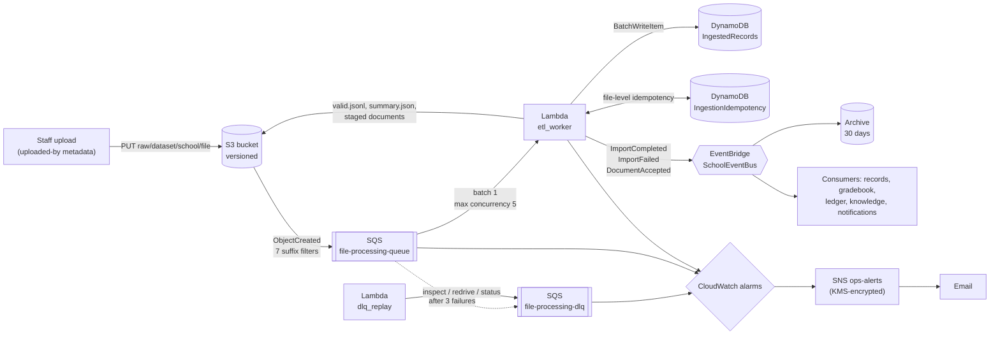

# School ingestion service

[](https://github.com/OWNER/REPO/actions/workflows/ci.yml)

A serverless bulk-file ingestion service for a multi-tenant school management system on
AWS, written in Python with the AWS CDK. School staff upload class rosters, marks and fee
schedules (CSV, JSON or JSONL) and policy documents (PDF, Word, Markdown, text). The
service validates every row, stages the valid records, writes an audit report, and
announces the result on a shared EventBridge bus so that other services (student records,
gradebook, fee ledger, knowledge base) can pick up the data they own.

It is not the source of truth for any domain data: everything it stages expires
automatically. Most of the data subjects are minors, so personal data never appears in
logs, metrics, events or error messages, and retention is set by data-protection needs
(South Africa's POPIA) rather than storage cost.

The service was built from a written specification ([`docs/INGESTION_BUILD_PROMPT.md`](docs/INGESTION_BUILD_PROMPT.md))
and publishes the events defined in the system's event catalogue
([`docs/EVENT_CATALOGUE.md`](docs/EVENT_CATALOGUE.md)). Where the build departed from the
specification, the reasons are recorded under [Design decisions](#design-decisions).

## Architecture



An upload to `raw/<dataset>/<school>/<file>` triggers an S3 notification on the queue. The
worker takes one file per invocation, checks its path, size and metadata, then streams it:
each row is validated against a pydantic schema, valid rows are written to DynamoDB in
batches of 25 and streamed to `valid.jsonl` with a multipart upload, and invalid rows are
collected with their line numbers. It writes `summary.json` and only then publishes one
event, so a consumer never receives an event whose files don't exist yet. Documents skip
row validation: their content is checked against the extension, and an immutable copy is
staged for the knowledge service. Files that are wrong (bad header, unknown dataset,
missing metadata) are a normal business outcome reported as `ImportFailed`; only
unexpected errors are retried and, after three attempts, land in the dead-letter queue,
which pages ops.

| Path | Contents | Expires |
|---|---|---|
| `raw/<dataset>/<school>/<file>` | uploads (`roster`, `marks`, `fee_schedule`, `documents`) | 30 days |
| `processed/<dataset>/<school>/<importId>/summary.json` | status, counts, row errors | 45 days |
| `processed/<dataset>/<school>/<importId>/valid.jsonl` | validated records (claim-check file) | 45 days |
| `processed/_rejected/<importId>/summary.json` | uploads whose path had an unknown dataset or invalid school ID | 45 days |
| `processed/documents/<school>/<documentId>/<version>/` | staged document and its summary | 45 days |

## Repository layout

```
app.py                      CDK entry point (SharedStack + IngestionStack, cdk-nag)
infra/
  shared_stack.py           event bus + 30-day archive, ops-alerts topic (KMS)
  ingestion_stack.py        everything below, wired together
  constructs/
    ingestion_bucket.py     bucket, lifecycle rules, native S3 -> SQS notifications
    processing_queue.py     queue + DLQ, S3 notification destination (queue policy)
    staging_tables.py       IngestedRecords, IngestionIdempotency
    worker_function.py      etl_worker Lambda, least-privilege role, SQS trigger
    replay_function.py      dlq_replay Lambda
    dependencies_layer.py   arm64 layer (built by scripts/build_layer.sh)
    ops_alarms.py           three alarms -> ops-alerts
src/ingestion/
  handlers/                 etl_worker.py, dlq_replay.py (thin: wiring only)
  pipeline.py               per-file processing (route, pre-check, validate, stage, publish)
  datasets.py               dataset registry and upload-key routing
  schemas/                  pydantic v2 models: roster, marks, fee_schedule
  parsing/                  streaming CSV / JSON (ijson) / JSONL readers
  storage/                  multipart JSONL writer, BatchWriteItem with retries
  documents.py              content checks, document ID and version
  events.py, reporting.py   event envelope + publisher, summary + error report
  replay.py                 DLQ inspect / redrive / status
tests/
  unit/                     moto-backed tests of the code (incl. the handlers)
  infra/                    CDK assertion tests of the synthesized templates
  integration/              opt-in tests against a deployed account
  fixtures/                 sample valid, invalid and malformed files
scripts/                    build_layer.sh, upload_sample.sh, dlq.sh, setup_github_oidc.sh
docs/                       the build specification and the event catalogue
```

## Quick start (local)

Requirements: Python 3.12 or later (3.14 matches Lambda), Node.js 22 or later, and on
Linux a `~/.cache` that isn't group-writable (the jsii runtime refuses to use it otherwise).

```bash
python3 -m venv .venv && source .venv/bin/activate
pip install -e ".[infra,runtime,dev]"
npm install -g aws-cdk

pytest -m "not slow"     # ~20 s; plain `pytest` also runs the slow tests (~2.5 min)
ruff check . && mypy     # mypy --strict on src/
./scripts/build_layer.sh # arm64 dependency layer -> build/layer (no Docker)
cdk synth                # fails on any unacknowledged cdk-nag finding
```

The Lambda Python version is set once, in `.lambda-python-version`, and read by the layer
build, the CDK constructs and CI.

## Deploy

You need AWS CLI v2 configured for the target account (`aws sts get-caller-identity`
should work) and a default region.

```bash
./scripts/build_layer.sh
cdk bootstrap                                      # once per account and region
cdk deploy --all -c alertEmail=you@example.com     # SchoolSharedStack, then SchoolIngestionStack
```

AWS emails a confirmation link for the alert subscription; alerts arrive only after it is
clicked. Pass `-c alertEmail=...` on every deploy: without it CDK removes the subscription.

## Uploading files

`scripts/upload_sample.sh` uploads a file with the required metadata, waits for the
result and prints `summary.json`:

```bash
scripts/upload_sample.sh tests/fixtures/marks_valid.csv marks SCH-001 term4.csv
scripts/upload_sample.sh tests/fixtures/roster_mixed.csv roster SCH-001 intake.csv
AUDIENCE=STAFF,PARENT TITLE="Code of Conduct 2027" \
  scripts/upload_sample.sh policy.pdf documents SCH-001 policies/code_of_conduct.pdf
```

With the plain CLI, the `uploaded-by` metadata is required (documents also need
`audience`, and accept an optional `title`):

```bash
aws s3 cp tests/fixtures/marks_valid.csv \
  s3://school-ingestion-<account>-<region>/raw/marks/SCH-001/term4.csv \
  --metadata uploaded-by=USR-teacher-0042
```

| Dataset | Formats | Limit | Natural key |
|---|---|---|---|
| `roster` | `.csv` `.json` `.jsonl` | 20 MB | `student_number` |
| `marks` | `.csv` `.json` `.jsonl` | 20 MB | `student_number` + `assessment_code` + `term_code` |
| `fee_schedule` | `.csv` `.json` `.jsonl` | 20 MB | `grade_code` + `term_code` + `fee_item` |
| `documents` | `.pdf` `.docx` `.md` `.txt` | 25 MB | the path (stable `documentId`) |

## Reading the results

Every upload produces a `summary.json`. A file with some bad rows still imports the good
ones (`COMPLETED_WITH_ERRORS`); each bad row is reported with its line number (the CSV
header is line 1; for JSON arrays it is the 1-based item number), the field, an error
code and the offending value, truncated to 100 characters. The first 1,000 errors are
listed and all of them are counted.

```json
{
  "importId": "imp-4ea2a10c01d5",
  "sourceFileKey": "raw/roster/SCH-001/intake.csv",
  "datasetType": "ROSTER",
  "schoolId": "SCH-001",
  "status": "COMPLETED_WITH_ERRORS",
  "totalRows": 4,
  "validRows": 1,
  "invalidRows": 3,
  "errorsTruncated": false,
  "errors": [
    {"line": 4, "field": "class_code", "errorCode": "class_grade_mismatch",
     "message": "class_code must start with the grade_code", "value": "9B"}
  ]
}
```

A failed file has `"status": "FAILED"` and a `reasonCode`:

| `reasonCode` | Meaning |
|---|---|
| `UNSUPPORTED_FORMAT` | unknown dataset, invalid school ID, wrong extension for the dataset, or document content that doesn't match its extension |
| `FILE_TOO_LARGE` | over the dataset's size limit |
| `HEADER_MISMATCH` | CSV header isn't exactly the schema's columns (any order) |
| `MISSING_METADATA` | no `uploaded-by`, or (documents) a missing or invalid `audience` |
| `UNREADABLE` | not UTF-8, malformed JSON or JSONL anywhere in the file, or the version was deleted |
| `NO_VALID_ROWS` | no data rows, or every row failed (the errors are still listed) |

When the path itself can't be trusted (unknown dataset or invalid school ID), the summary
goes to `processed/_rejected/<importId>/summary.json` and the event carries `UNKNOWN` for
the untrusted part: an unvalidated path component is never reused in a new S3 key.

## Events

Published on `SchoolEventBus` with source `school.ingestion`, exactly as defined in the
[event catalogue](docs/EVENT_CATALOGUE.md). Every event carries the common metadata block
(a ULID `eventId`, `correlationId` = the import ID, `schoolId`) and identifiers only:
record contents stay in the claim-check files.

| `detail-type` | When | Key fields |
|---|---|---|
| `ImportCompleted` | a tabular file had at least one valid row | `datasetType`, counts, `validRecordsKey`, `summaryKey` |
| `ImportFailed` | any file-level failure | `reasonCode`, `summaryKey`, `uploadedBy` (or `null`) |
| `DocumentAccepted` | a document passed its checks | `documentId`, `version`, `audience`, `stagedKey` |

## Operations

### Alarms

| Alarm | Fires when |
|---|---|
| `ingestion-dlq-not-empty` | any message is in `file-processing-dlq` (1 minute) |
| `ingestion-queue-oldest-message-age` | the oldest queued message is over 15 minutes old |
| `ingestion-worker-errors` | a worker invocation failed in the last 5 minutes |

Each alarm also notifies when it returns to OK. Bad files never raise an alarm. To check
delivery end to end:

```bash
aws cloudwatch set-alarm-state --alarm-name ingestion-dlq-not-empty \
  --state-value ALARM --state-reason "Testing alert delivery"
```

### Logs and metrics

Worker logs are structured JSON in the `EtlWorker` log group, with the object key as the
`correlation_id` and the import ID, school and dataset on every line. They contain counts,
keys and error codes only, never record contents or error values. Metrics are published
to the `SchoolSystem/Ingestion` namespace with a `DatasetType` dimension:
`ProcessedRecordsCount`, `ValidRecordsCount`, `ValidationFailureCount`,
`ImportsFailedCount` (also by `ReasonCode`), `DocumentsAcceptedCount` and
`PipelineLatency` (milliseconds from the S3 event to publication).

### DLQ runbook

A message reaches the DLQ only after the worker failed on it three times with an
unexpected error (an AWS outage, a bug, a malformed notification). Each retry waits for
the 30-minute visibility timeout, so this takes about 1.5 hours.

| Step | Action |
|---|---|
| 1. Alert | `ingestion-dlq-not-empty` emails ops. |
| 2. Inspect | `scripts/dlq.sh inspect` lists bucket, key, versionId, ETag, receive count and first-failure time, without deleting anything. |
| 3. Diagnose | Search the worker log group for the key (the `correlation_id` on every line). |
| 4. Fix | Deploy a fix, or wait out the outage. |
| 5. Redrive | `scripts/dlq.sh redrive` moves the messages back to the main queue. |
| 6. Confirm | `scripts/dlq.sh status` until `COMPLETED`; `scripts/dlq.sh inspect` shows 0; the alarm emails OK. |

To rehearse without waiting 1.5 hours, put a copy of an already-processed file's
notification straight into the DLQ, then follow steps 2, 5 and 6. Idempotency makes the
worker skip the redriven duplicate (within 24 hours; after that it reprocesses the file
under the same import ID, which rewrites identical output and publishes again).

```bash
out() { aws cloudformation describe-stacks --stack-name SchoolIngestionStack \
  --query "Stacks[0].Outputs[?OutputKey=='$1'].OutputValue" --output text; }
BUCKET=$(out BucketName); DLQ=$(out DeadLetterQueueUrl)
KEY=raw/marks/SCH-001/term4.csv
VERSION=$(aws s3api head-object --bucket "$BUCKET" --key "$KEY" --query VersionId --output text)
aws sqs send-message --queue-url "$DLQ" --message-body "{\"Records\":[{\"eventTime\":\"$(date -u +%FT%TZ)\",\"s3\":{\"bucket\":{\"name\":\"$BUCKET\"},\"object\":{\"key\":\"$KEY\",\"size\":1,\"eTag\":\"drill\",\"versionId\":\"$VERSION\"}}}]}"
```

## Testing

| Suite | Command | What it covers |
|---|---|---|
| Unit | `pytest tests/unit` | parsing, schemas, the pipeline and both handlers end to end against moto (S3, DynamoDB, EventBridge, SQS) |
| Infrastructure | `pytest tests/infra` | the synthesized CloudFormation: queue settings, notifications, lifecycle, IAM, alarms, cdk-nag acknowledgements |
| Slow | part of plain `pytest` | multipart uploads over 5 MiB, and a file just under 20 MB processed with peak memory measured by `tracemalloc` |
| Integration | `pytest -m integration` | uploads to the deployed stacks, waits for `summary.json` and captures the real event through a temporary rule; also proves the arm64 layer imports on Lambda |

Tests that guard important properties were checked by mutation: breaking the property on
purpose (logging a row value, publishing before the summary exists, keying idempotency on
the ETag, dropping a queue-policy condition) makes at least one test fail.

## CI/CD

[`.github/workflows/ci.yml`](.github/workflows/ci.yml) runs on every push and pull
request: `ruff`, `mypy --strict`, all unit and infrastructure tests including the slow
ones, the arm64 layer build, and `cdk synth` with cdk-nag, on the Lambda's Python version.

On pushes to `main`, a second job deploys to a dev account and runs the integration tests.
It authenticates with GitHub OIDC, so no AWS keys are stored in GitHub. One-time setup,
outside these stacks:

```bash
scripts/setup_github_oidc.sh <github-owner> <repo-name>
```

The script creates the GitHub OIDC identity provider (if the account doesn't have one)
and a role, `school-ingestion-github-deploy`, that only jobs in the `dev` environment of
that repository can assume. The role can assume the CDK bootstrap roles (which do the
actual deployment) and run the integration tests, nothing more. Then, in the repository's
**Settings → Environments**, create an environment named `dev` with the variables the
script prints: `AWS_DEPLOY_ROLE_ARN`, `AWS_REGION` and, optionally, `ALERT_EMAIL`. The
deploy job is skipped until `AWS_DEPLOY_ROLE_ARN` is set.

## Design decisions

### Backpressure with the event source mapping's maximum concurrency

The SQS trigger has `MaximumConcurrency: 5` and the function has no reserved concurrency.
Reserved concurrency throttles the SQS poller, and throttled messages still count as
receive attempts, so a burst of uploads could push perfectly good files into the DLQ
without them ever failing. Maximum concurrency limits how many invocations the poller
starts instead. The queue's visibility timeout is six times the worker's timeout (1,800 s),
as AWS recommends, so a message isn't redelivered while an earlier attempt is still running.

### File-level idempotency keyed on the S3 version

The import ID is a hash of bucket, key and S3 `versionId`, and the whole per-file run is
wrapped in Powertools idempotency. A redelivered notification for the same object version
is skipped; a deliberate re-upload of an identical file is a new version, and therefore a
new import. Keying on the ETag would have silently dropped those re-uploads. Bucket
versioning is required for this, and a notification without a `versionId` is treated as a
deployment fault rather than a bad file. Idempotency is at file level because
`BatchWriteItem` has no condition expressions; rewriting an item with the same keys is
naturally idempotent.

### Claim-check events and an internal staging table

Events carry S3 keys, not data: EventBridge caps events at 256 KB, and keeping records out
of events keeps minors' personal data out of the event archive, logs and DLQs. Consumers
read `valid.jsonl`. The `IngestedRecords` table is internal: no other service is granted
access. It keeps a per-key history across imports (a `record_hash` makes conflicting
re-uploads visible) and demonstrates batched writes with retries; no consumer depends on it.

### Publish last, and bad files are not errors

The event is published only after the DynamoDB writes, `valid.jsonl` and `summary.json`
have all succeeded, and a failed `PutEvents` entry raises so the file is retried. A bad
file, though, returns success after publishing `ImportFailed`: retrying it three times
would only fill the DLQ and page ops for something the uploader needs to fix.

### Retention: 30 and 45 days, and old versions after 1 day

Retention is set by data minimisation, not storage cost. `raw/` expires after 30 days.
`processed/` expires after 45 days, longer than the 30-day event archive, so a replayed
event still finds its claim-check files. On a versioned bucket, expiring an object only
makes it a noncurrent version, so noncurrent versions expire after 1 day: the bytes are
really gone after about 31 and 46 days (expiring them after 30 days, as first specified,
would have kept personal data for about 60 and 75 days). Lifecycle expiry is
asynchronous, so objects can remain a day or two past these dates. There is no
Standard-IA or Glacier transition: their minimum storage charges (30 and 90 days) cost
more than they save at these retention periods.

### A 20 MB limit for tabular files

A real roster or marks file is well under 1 MB. The cap keeps a worst-case file within
the worker's 300-second timeout. Measured locally, a file just under 20 MB (about 480,000
rows) peaks at 66 MB of memory and takes about 20 seconds of CPU, but it needs about
19,000 sequential `BatchWriteItem` calls, so on Lambda it would take minutes and come
close to the timeout. See [Known limitations](#known-limitations-and-future-work).

### S3 notifications without a custom resource

S3 allows one prefix and one suffix per notification filter, so there are seven
notifications (`raw/` plus each extension), generated in a loop. CDK's usual
`add_event_notification` deploys a helper Lambda (a custom resource) to install them,
whose role uses the `AWSLambdaBasicExecutionRole` managed policy, and its built-in SQS
destination conditions the queue policy on `aws:SourceArn` only. Here the notification
configuration is set natively on the bucket instead, through a small notification
destination whose single queue-policy statement requires both `aws:SourceArn` and
`aws:SourceAccount` (a bucket ARN contains no account ID). The bucket ARN in that
statement is built from the bucket's name, which avoids a circular dependency and lets the
bucket depend on the queue policy, so S3's validation message is accepted when the
notifications are created. The queues use SQS-managed encryption: with a customer-managed
key, S3 would also need key-policy grants, a common cause of silently missing
notifications.

### Strict, streaming, privacy-preserving parsing

Files are read incrementally: CSV through `codecs.iterdecode` into the `csv` module,
JSON arrays through `ijson`, JSONL line by line. The body is split on `\n` by a small
helper rather than botocore's `iter_lines()`, which splits with `bytes.splitlines` and
turns a `\r\n` that straddles a chunk boundary into two line breaks, shifting every later
line number. The schemas are stricter than pydantic's defaults: lax integer parsing would
accept `"1500.00"`, `1500.0` and even `True` as a whole number of cents, and lax date
parsing would accept a Unix timestamp as a date of birth. Numbers are never floats
(`Decimal` throughout). Two rows with the same natural key in one file keep the first and
report the second as `duplicate_key`; otherwise DynamoDB would reject the whole batch.
Library error messages from `ijson`, `json` and `csv` quote the input, so file-level
failures carry fixed descriptions instead.

### Least privilege and cdk-nag

The roles use inline policies only (no AWS managed policies), no `Action: "*"`, and
wildcards only as prefixes on this service's own bucket (`raw/*`, `processed/*`) and for
X-Ray, which requires `Resource: "*"`. cdk-nag's AwsSolutions pack runs on every synth and
fails it on any unacknowledged finding. The acknowledgements are per finding rather than
per rule, so a new wildcard still fails the build, and a test checks each one against an
approved list:

| Finding | Where | Reason |
|---|---|---|
| `AwsSolutions-S1` | ingestion bucket | no server access logs: a log bucket would itself need logging; in production, CloudTrail S3 data events are the better audit trail |
| `AwsSolutions-IAM5` | worker role | the `raw/*` and `processed/*` prefixes, and X-Ray's `*` |
| `AwsSolutions-L1` | both functions | Python 3.14 is the newest runtime that is GA on Lambda and supported by Powertools; 3.15 is a Lambda preview |

### What the first real deployment found

Three problems only showed up on real AWS, and each now has a regression test:

- **Alarms were silently dropped.** `enforce_ssl=True` on the alarm topic attaches a
  topic policy that only denies non-HTTPS requests, and a topic policy replaces SNS's
  default policy, which is what normally lets CloudWatch publish. Alarm history showed
  "CloudWatch Alarms is not authorized to perform: SNS:Publish". The topic policy now
  explicitly allows `cloudwatch.amazonaws.com`, limited to this account's alarms. The
  topic's KMS key policy follows AWS's documented form, without a source-account condition.
- **Redrive needed `sqs:DeleteMessage`.** `StartMessageMoveTask` moves messages as the
  caller (receive, send, delete), so the DLQ tool's role needs `DeleteMessage` on the DLQ
  as well as the permissions first specified.
- **Finished redrives have no task handle.** `ListMessageMoveTasks` includes a task's
  handle only while it is running, so `scripts/dlq.sh status` reports the latest task
  instead of looking one up by handle. The original unit test had stubbed a response with
  a handle on a finished task, the same wrong assumption as the code, which is why the
  real-account drill was worth running.

Two smaller behaviours are worth knowing. With one message per batch, a failure makes
Powertools raise rather than return a partial-failure response, so the invocation
errors: SQS still retries the message, and the worker-errors alarm sees it (a quietly
reported partial failure would not). And the cross-stack references between the two
stacks are pinned to CDK's "strong" mode, which stops the shared stack from being deleted
while the ingestion stack still uses it.

## Knowledge service (in progress)

A second service in this CDK app answers staff and parents' questions from school
documents, with citations (retrieval-augmented generation). It consumes the
`DocumentAccepted` events published above. Specification:
[`docs/KNOWLEDGE_SERVICE_BUILD_PROMPT.md`](docs/KNOWLEDGE_SERVICE_BUILD_PROMPT.md).

| Phase | Scope | State |
|---|---|---|
| a | Cognito user pool, knowledge bucket, S3 Vectors index, registry tables, indexing queue, arm64 layer | done |
| b | provider interfaces, fakes, Gemini / Voyage / Claude adapters | done |
| c | text extraction and chunking | done |
| d | indexer end to end | not started |
| e | query API | not started |
| f | admin operations, alarms, metrics | not started |
| g | evaluation harness and README | not started |

Models and the vector index are configured in `cdk.json` (`embeddingProvider`,
`embeddingModel`, `embeddingDimension`, `vectorIndexVersion`, `generationProvider`,
`generationModel`, `generationThinking`, `generationEffort`). The index name is derived from them, for example
`docs-gemini-768-v1`, because an index only makes sense for the model that produced its
vectors. `scripts/build_layer.sh` now builds both dependency layers.

Provider choices, checked against each provider's documentation on 2026-11-11:

| Role | Default | Notes |
|---|---|---|
| Embeddings | Gemini `gemini-embedding-2`, 768 dimensions | no `task_type`: retrieval hints go in the text (`title: … \| text: …` for documents, `task: question answering \| query: …` for questions); batches via `batchEmbedContents` (max 100) |
| Embeddings (alternative) | Voyage `voyage-4`, 1024 dimensions | `input_type` document/query; only 256/512/1024/2048 dimensions |
| Generation | Claude `claude-haiku-5-5`, thinking `disabled`, effort `low` | no `temperature` on current Claude models; thinking counts toward the 600-token answer budget |
| Generation (alternative) | Gemini `gemini-3.5-flash-lite`, thinking `minimal` | `maxOutputTokens` includes thinking tokens |

Extraction keeps structure: PDF text per page (running headers and footers removed,
hyphenated line breaks joined, scanned PDFs rejected as `NO_EXTRACTABLE_TEXT`), DOCX
headings and tables (`cell | cell | cell`), Markdown `#` headings and plain-text
paragraphs. Chunks follow headings and paragraphs and break only between sentences:
about 500 tokens, never more than 800, with about 75 tokens of whole-sentence overlap.
Each chunk is embedded as `<title> > <heading path>` plus its text, and chunks too small
to stand alone are merged into a neighbour rather than dropped.

API keys live in Secrets Manager, one secret per provider. Store them with
`scripts/set_provider_key.sh gemini|voyage|anthropic` (hidden prompt; the key never
touches shell history or disk), then check the real APIs with `pytest -m integration`.

## Cost and teardown

Idle, the service costs about US$1 a month, for the KMS key that encrypts the alert
topic. Everything else is pay-per-use (Lambda, SQS, on-demand DynamoDB, S3, EventBridge,
CloudWatch metrics and alarms) and costs cents at school volumes; point-in-time recovery
on the two small tables adds very little.

The bucket is versioned, so empty it, including old versions, before destroying the stacks:

```bash
BUCKET=school-ingestion-$(aws sts get-caller-identity --query Account --output text)-$(aws configure get region)
python3 -c "import boto3,sys; boto3.resource('s3').Bucket(sys.argv[1]).object_versions.delete()" "$BUCKET"
cdk destroy --all
```

## Known limitations and future work

- **Large files**: split tabular files over 20 MB by byte range with a Step Functions
  Distributed Map. Before raising the limit, parallelise the `BatchWriteItem` calls (or
  drop the per-row staging writes), which dominate a worst-case file's run time.
- **Authenticated uploads**: presigned upload URLs issued by an authenticated API
  (Cognito), which would set `uploaded-by` instead of the CLI.
- **Per-tenant upload quotas.**
- **A DLQ consumer** that publishes `ImportFailed` with `MOVED_TO_DLQ`, so uploaders hear
  about files that failed for unexpected reasons.
- **OCR for scanned PDFs**, a knowledge-service concern.
- **Deleted versions**: without `s3:ListBucket`, S3 may answer 403 rather than 404 for a
  permanently deleted version, so such a file is retried into the DLQ instead of being
  reported as `UNREADABLE`.
- **Non-ASCII document titles**: S3 user metadata is ASCII, so a non-ASCII `title` should
  be RFC 2047-encoded by the uploader and decoded here.
